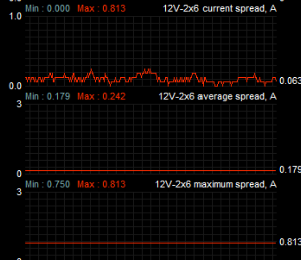

# AmpSpread Afterburner Edition

**A lightweight, standalone MSI Afterburner plugin for monitoring 12V-2×6 cable current balance.**

### [View latest release & downloads](https://github.com/AmpSpread/AmpSpread-Afterburner-Edition/releases/latest)

AmpSpread adds live, average, and peak **per-pin current spread** readings to Afterburner's hardware monitor. It calculates the difference between the **highest** and **lowest** of six pin currents, using values already provided by MSI's `PSU.dll`. **No separate AmpSpread application or additional PSU polling is required.**



*AmpSpread running in MSI Afterburner 4.6.7 Beta 3 with an MSI MPG Ai1600TS PSU.*

## Monitoring graphs

| Sensor | What it shows |
| --- | --- |
| **Current spread** | Live highest-pin minus lowest-pin current (A) |
| **Average spread** | Elapsed-time-weighted average of reported spread (A) |
| **Maximum spread** | Largest spread observed during the session (A) |
| **Active port** | Automatically selected 12VHPWR port (1 or 2) |
| **Data complete** | `1` = six currents available; `0` = missing/incomplete |

All spread readings display to three decimal places. Default graph limits are 0–1 A (current/maximum) and 0–0.5 A (average). The active port is selected from complete sets of six pins, with the higher total current taking precedence; statistics are kept independently for each port.

## Installation

1. Open **Latest release & downloads** above and download `ampspread.dll` from the release's **Assets**.
2. Completely exit MSI Afterburner, including its system-tray process.
3. Copy `ampspread.dll` into:
   `C:\Program Files (x86)\MSI Afterburner\Plugins\Monitoring\`
4. Restart Afterburner. Go to **Settings → Monitoring → […]**, enable **ampspread.dll**, and enable the desired graphs.
5. Optional: copy the repository's `Help/Plugins/Monitoring/ampspread` file into Afterburner's matching help directory for the plugin description.

If you used the older **PSUSpread** plugin, remove `PSUSpread.dll` to prevent duplicate sensors.

**Requirements:** MSI Afterburner for Windows with support for 32-bit monitoring plugins, the built-in `PSU.dll` module enabled, and a compatible PSU exposing six individual 12V-2×6 currents in amperes. Developed using the **MSI MPG Ai1600TS**.

## Using AmpSpread

**Reset statistics:** Configure **Clear monitoring history** in MSI Afterburner's Monitoring settings and use that hotkey. AmpSpread v1.0.4 detects the same shortcut and resets its own average and maximum spread without restarting Afterburner. The Setup dialog displays hotkey diagnostics and still supports a manual reset (choose **Yes**). The DLL reads the active `Profiles\\MSIAfterburner.cfg` with installation-root fallback. Match GPU load, test duration and polling interval for cable comparisons.

**How it works:**

```text
MSI PSU → PSU.dll → Afterburner shared memory
                               ↓ read-only
                          ampspread.dll
                               ↓
                    Spread monitoring graphs
```

The DLL only reads current values **already published by Afterburner**. It does not send commands to the PSU, change Safeguard+ settings, install a driver, or run a background service.

## v1.0.4 changes

- Clear monitoring history hotkey resets AmpSpread's accumulated average and maximum.
- Five monitoring sources have distinct instance identities, helping keep graph statistics independent.
- Preserves the v1.0.3 time-weighted average, data-complete indicator and long-gap handling.
- [Full changelog](CHANGELOG.md) · [v1.0.4 release notes](RELEASE_NOTES_v1.0.4.md)

## Important notes

- The average uses elapsed-time weighting to reduce callback-rate bias; it still represents **published monitoring values**, not every physical PSU sample.
- Previously saved Afterburner graph ranges may override the defaults. Refresh timing and any lag introduced by the host's sensor-polling pipeline remain outside the DLL's control.
- Missing or incomplete data is marked unavailable rather than presented as a legitimate zero spread; the **Data complete** sensor shows this separately.
- **Current balance alone cannot prove a connector safe.** Seating, resistance, temperature, and other faults matter. AmpSpread is **monitoring-only**, not a hardware protection or shutdown mechanism.
- The DLL is **unsigned**; release assets include a SHA-256 checksum for integrity verification. Don't disable Windows security features just to run it.

## Source and development

- [Source code](src/ampspread.c) · [Windows build script](build-windows.cmd) · [Linux cross-build script](build-linux.sh) · [Automated tests](tests/test_spread.c)
- [All releases and previous versions](https://github.com/AmpSpread/AmpSpread-Afterburner-Edition/releases)
- [MIT license](LICENSE)

This is an independent community project, **not officially affiliated with MSI**, and is separate from the full AmpSpread desktop application.
